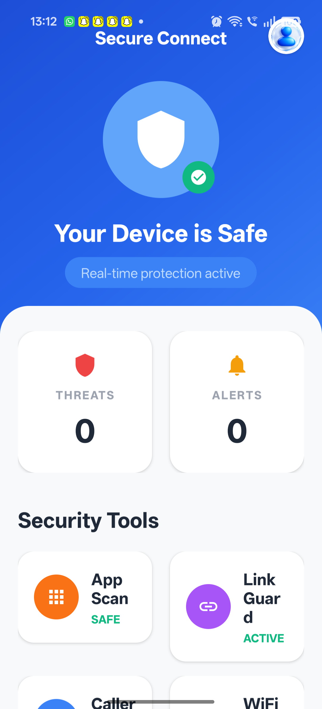
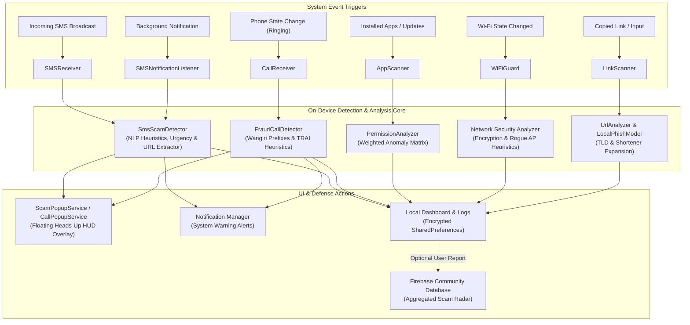

# 🛡️ Secure Connect — On-Device Cyber Scam Shield & Fraud Radar

<p align="center">
  
</p>

<p align="center">
  <b>Real-Time, Privacy-First Cyber Defense Shield for Android.</b><br/>
  Detects and neutralizes SMS phishing, Wangiri spam calls, predatory loan apps, rogue Wi-Fi hotspots, and malicious URLs—powered by on-device NLP heuristics and ML.
</p>

<p align="center">
  <a href="https://github.com/KunalJaggi-20/Secure-Connect/stargazers"></a>
  <a href="https://github.com/KunalJaggi-20/Secure-Connect/network/members"></a>
  <a href="https://github.com/KunalJaggi-20/Secure-Connect/blob/main/LICENSE"></a>
  
  
  
  
</p>

---

## 📌 Executive Summary

Digital fraud, social engineering, and financial cybercrimes are growing at an alarming pace—disproportionately targeting elderly citizens, first-time smartphone users, and digital banking customers. Common vectors include:
- **KYC & Bank Account Freeze Threats** ("Your SBI/HDFC/PNB account will be blocked within 24 hours...")
- **Electricity & Utility Power-Cut Scams** ("Pay immediately or power disconnected tonight at 9:30 PM...")
- **Wangiri & International Spoofed Calls** (One-ring callbacks from high-tariff premium rate numbers)
- **Predatory Instant-Loan & Cloned Apps** (Malicious APKs that harvest contacts and extort users)
- **Open Wi-Fi Honeypots & URL Shorteners** (Stealing credentials via MITM or phishing redirects)

**Secure Connect** is an intelligent, lightweight, and **strictly on-device cybersecurity shield** built in Kotlin. It intercepts threats at the OS boundary—evaluating incoming SMS, phone calls, background notifications, installed app permissions, network handshakes, and clipboard URLs in real time.

> 🔒 **Privacy-First Guarantee**: **Zero data harvesting.** SMS messages, call logs, and contacts are analyzed locally on your device using optimized rule heuristics and ML models. Your private communications never leave your phone.

---

## 📱 App Interface & Visual Tour

<p align="center">
  
</p>

---

## ⚡ Core Defense Modules

### 1. 📩 SMS Phishing & Coercion Guard (Real-Time NLP Engine)
- **Semantic Urgency & Coercion Detection**: Analyzes threat psychology (e.g., *"urgent action required"*, *"within 24 hours"*, *"legal notice"*).
- **Targeted Fraud Signatures**:
  - **Banking & KYC Scams**: Impersonation of major Indian banks, YONO, PAN/Aadhaar updates, and blocked debit cards.
  - **Utility Extortion**: Power supply disconnection alerts and bogus electricity office contacts.
  - **UPI & Lottery Traps**: Fake KBC rewards, lucky draws, scratch cards, and cashback schemes.
  - **Task & Job Fraud**: Work-from-home, Telegram review tasks, and fake daily payout schemes.
- **Header & Sender Verification**: Flags 10-digit standard mobile numbers masquerading as official bank or telecom sender IDs (e.g., `AX-HDFCBK` vs `+91 9876543210`).
- **Dual-Layer Interception**:
  - `SMSReceiver` (Priority 1000) for instant broadcast capture.
  - `SMSNotificationListener` fallback to catch SMS previews even when Secure Connect is not the default SMS app.
- **Instant Floating HUD**: Displays an animated, debounced floating alert overlay (`ScamPopupService`) directly over dangerous messages.

### 2. 📞 AI Call Radar & Wangiri Spam Shield
- **Zero-Latency In-Call Assessment**: Evaluates incoming caller numbers before the user picks up.
- **International Telecom Threat Intelligence**: Flags high-risk international prefixes associated with Wangiri fraud and global syndicates (`+234`, `+92`, `+232`, `+880`, `+252`, `+387`, `+247`, etc.).
- **TRAI Telemarketer Identification**: Automatically detects official commercial telemarketing series (`140`, `0140`, `+91140`).
- **Emergency Code Whitelisting**: Preserves recognized emergency lines (`100`, `108`, `112`, `1930` Cyber Cell helpline).
- **Floating Heads-Up Alert**: Displays caller reputation tag, threat level, and safety warnings during the ringing state.
- **Interactive Number Lookup**: In-app query tool to inspect any unfamiliar phone number on demand.

### 3. 📦 App Risk Scanner & Permission Auditor
- **Predatory & Fake App Fingerprinting**: Scans installed applications against malicious signatures (predatory loan apps, bogus wallet clones, fake KYC assistants, crypto scams).
- **Installer Source Verification**: Distinguishes Google Play Store verified installations from sideloaded, unknown, or third-party APKs.
- **Contextual Permission Risk Scoring**:
  - Assigns severity weights to sensitive Android permissions (`READ_SMS`, `RECEIVE_SMS`, `READ_CALL_LOG`, `SYSTEM_ALERT_WINDOW`, `BIND_ACCESSIBILITY_SERVICE`).
  - Detects permission anomalies (e.g., a flashlight, game, or calculator demanding SMS and Call Log access).
- **Permission Creep Tracking**: Monitors privilege escalation across application updates.
- **1-Tap Uninstaller**: Direct shortcut to purge dangerous apps via Android Package Manager.

### 4. 🌐 Malicious Link & Phishing URL Scanner
- **Heuristic Threat Engine**: Inspects URLs for deceptive structures, raw IPv4/IPv6 hosts, and excessive subdomains.
- **Suspicious TLD Detection**: Flags high-abuse top-level domains (`.xyz`, `.top`, `.buzz`, `.monster`, `.online`, `.site`).
- **URL Shortener Expansion**: Detects masking via `bit.ly`, `tinyurl.com`, `is.gd`, `cutt.ly`, `wa.me`, `t.me`, and more.
- **Clipboard Sniffer**: Automatically reads copied links upon opening the scanner for effortless one-tap audits.
- **Safe Browser Routing**: Prevents accidental redirection to malicious sites.

### 5. 📶 Wi-Fi Guard & Network Threat Shield
- **Encryption Handshake Audit**: Distinguishes secure WPA2/WPA3 enterprise connections from open, unprotected Wi-Fi networks.
- **Honeypot & Rogue AP Detection**: Flags suspicious SSIDs using deceptive keywords (`"Free"`, `"Public"`, `"Guest"`, `"Open Airport"`).
- **Signal & Metric Diagnostics**: Real-time signal strength (RSSI in dBm), link speed (Mbps), frequency band (2.4 GHz vs 5 GHz), and local IP allocation.

### 6. 🧪 Simulation Suite & Live Test Mode
- Built-in test sandbox in `SmsSummaryActivity` and `CallHistoryActivity`.
- Allows security reviewers, judges, and developers to trigger realistic simulated phishing SMS and scam calls with 1 click to test HUD overlays and notification pipelines safely.

---

## 🏗️ Architecture & Data Flow



---

## 🛠️ Technology Stack

| Component | Technology / Library | Details |
|---|---|---|
| **Language** | Kotlin 2.0.21 | 100% Kotlin codebase |
| **Android SDK** | Min SDK 24 / Target SDK 36 | Android 7.0 (Nougat) to Android 15+ (Vanilla Ice Cream / 16) |
| **Architecture** | MVVM / Clean Architecture | Reactive, decoupled, lifecycle-aware components |
| **Concurrency** | Kotlin Coroutines & LifecycleScope | Non-blocking background scanning & thread isolation |
| **UI Framework** | Material Design 3 & ViewBinding | Custom card layouts, fluid spring/overshoot animators |
| **Services & Receivers** | Foreground Service (`specialUse`) | Android 14+ compliant foreground background security services |
| **Machine Learning & OCR** | Google ML Kit & TensorFlow Lite | Text recognition, OCR image scanning, on-device phishing model |
| **QR Code Scanner** | ZXing (`zxing-android-embedded:4.3.0`) | Instant QR fraud & phishing URL scanning |
| **Networking & API** | Retrofit 2.9.0 & OkHttp 4.12.0 | Asynchronous threat verification and safety reports |
| **Cloud Integration** | Firebase (Auth, Realtime Database) | Crowdsourced threat intelligence and user profile safety syncing |
| **Media & Education** | Android YouTube Player | Integrated cyber awareness video library |

---

## 📂 Project Directory Structure

```text
Secure-Connect/
├── app/
│   ├── src/
│   │   ├── main/
│   │   │   ├── java/com/example/paisacheck360/
│   │   │   │   ├── MainActivity.kt               # Main dashboard & real-time security score
│   │   │   │   ├── SmsScamDetector.kt            # On-device SMS NLP & scam trigger heuristics
│   │   │   │   ├── FraudCallDetector.kt          # Telemarketing & international call threat radar
│   │   │   │   ├── AppScanner.kt                 # Installed package & permission risk scanner
│   │   │   │   ├── PermissionAnalyzer.kt         # Dangerous permission weighting matrix
│   │   │   │   ├── WiFiGuardActivity.kt          # Wi-Fi encryption & rogue AP analyzer
│   │   │   │   ├── LinkScannerActivity.kt        # Phishing link & URL inspector
│   │   │   │   ├── UrlAnalyzer.kt                # Heuristic URL and domain analysis engine
│   │   │   │   ├── ScamPopupService.kt           # Floating overlay HUD for SMS alerts
│   │   │   │   ├── CallPopupService.kt           # Floating overlay HUD for incoming scam calls
│   │   │   │   ├── SMSReceiver.kt                # High-priority incoming SMS broadcast receiver
│   │   │   │   ├── CallReceiver.kt               # Phone call state change receiver
│   │   │   │   ├── SMSNotificationListener.kt    # Notification interceptor fallback
│   │   │   │   ├── SmsSummaryActivity.kt         # SMS inbox scan & interactive simulation suite
│   │   │   │   ├── FraudCallSummaryActivity.kt   # Call log audit & number lookup dialog
│   │   │   │   ├── AppRiskScannerActivity.kt     # App security scanner UI & 1-tap uninstall
│   │   │   │   ├── ScamReportActivity.kt         # Incident report & cyber cell forwarding UI
│   │   │   │   └── ProfileActivity.kt            # User profile & authentication settings
│   │   │   ├── res/                              # Layouts, vector drawables, themes, and animations
│   │   │   └── AndroidManifest.xml               # Permissions, activities, receivers, and services
│   ├── build.gradle.kts                          # App module dependencies & SDK specifications
│   └── google-services.json                      # Firebase configuration
├── gradle/
│   └── libs.versions.toml                        # Version catalog (AGP 8.11.1, Kotlin 2.0.21)
├── build.gradle.kts                              # Root build file
├── screen_updated.png                            # Mobile app dashboard screenshot
└── README.md                                     # Project documentation
```

---

## 🔒 Permissions Transparency

Secure Connect only requests permissions strictly essential for user defense:

| Permission | Purpose | Privacy Safeguard |
|---|---|---|
| `RECEIVE_SMS` / `READ_SMS` | Intercept and inspect incoming phishing/scam text messages | Analyzed strictly on-device; messages are never uploaded |
| `READ_PHONE_STATE` / `READ_CALL_LOG` | Detect spoofed and high-risk international calls in real time | Caller logs remain local; used only to calculate risk scores |
| `READ_CONTACTS` | Whitelist known, trusted contacts from being flagged as spam | Contact list is never mirrored or synced to external servers |
| `SYSTEM_ALERT_WINDOW` | Display floating HUD warning popups over suspicious calls/SMS | Only triggered when high or critical threats are detected |
| `ACCESS_FINE_LOCATION` | Required by Android OS to retrieve Wi-Fi SSID and security state | Location data is not logged, stored, or transmitted |
| `QUERY_ALL_PACKAGES` | Inspect installed packages for predatory loan apps and trojans | Package names evaluated locally against threat signatures |
| `POST_NOTIFICATIONS` | Deliver high-priority security hazard notifications | Standard notification channel for critical threat warnings |

---

## 🚀 Getting Started & Installation

### Prerequisites
- **Android Studio**: Ladybug (2024.2.1+) or newer
- **JDK**: Java 11 or Java 17
- **Android Device / Emulator**: Running Android 7.0 (API 24) or higher
- **Android SDK Platform**: API Level 36 installed via SDK Manager

### Build from Source
1. **Clone the repository:**
   ```bash
   git clone https://github.com/KunalJaggi-20/Secure-Connect.git
   cd Secure-Connect
   ```

2. **Open in Android Studio:**
   - Select **Open an Existing Project** and navigate to the cloned directory.
   - Wait for Gradle sync to complete automatically using `libs.versions.toml`.

3. **Firebase Setup (Optional for local development):**
   - The repository includes a default development `google-services.json`.
   - If using your own Firebase project, replace `app/google-services.json` with the file generated from your Firebase Console (enable Authentication and Realtime Database).

4. **Build and Install:**
   ```bash
   # Build the debug APK
   ./gradlew assembleDebug

   # Or install directly to a connected device via ADB
   ./gradlew installDebug
   ```

---

## 🧪 How to Test & Demo

1. **Test SMS Scam Detection**:
   - Navigate to **SMS Guard** (`SmsSummaryActivity`).
   - Tap **"Test Live Alert"** or **"Simulate Scam"** to trigger a demonstration scam message (e.g., electricity disconnection or KYC update).
   - Observe the floating HUD alert overlay and comprehensive threat breakdown.
2. **Test Call Radar**:
   - Navigate to **Caller ID** (`FraudCallSummaryActivity`).
   - Tap the **Search / Lookup** icon and enter test numbers:
     - International Wangiri test: `+234 801 234 5678` (Evaluates to Critical Risk).
     - Commercial Telemarketing: `1409876543` (Identified as official marketing series).
     - Safe helpline: `1930` or `112` (Evaluates to Safe).
3. **Test Wi-Fi Security**:
   - Open **WiFi Guard** while connected to any Wi-Fi network.
   - View encryption protocol, BSSID, RSSI signal strength, and security posture.

---

## 🗺️ Roadmap & Upcoming Milestones

- [ ] **On-Device LLM Integration**: Incorporate Google Gemini Nano / MediaPipe for conversational context understanding.
- [ ] **Multilingual Support**: Hindi, Tamil, Telugu, Bengali, and Marathi scam dialect heuristics.
- [ ] **Voice Scam & Deepfake Detection**: Audio pattern recognition for urgent voice coercion calls.
- [ ] **Automated Cyber Cell Report (PDF Export)**: 1-click generation of formalized cyber complaint dossiers formatted for Indian Cyber Crime portal (`cybercrime.gov.in`).

---

## 🤝 Contributing

Contributions, issues, and feature requests are welcome!

1. Fork the Project
2. Create your Feature Branch (`git checkout -b feature/AmazingFeature`)
3. Commit your Changes (`git commit -m 'Add some AmazingFeature'`)
4. Push to the Branch (`git push origin feature/AmazingFeature`)
5. Open a Pull Request

---

## 📄 License

This project is open-source and distributed under the **MIT License**. See [`LICENSE`](LICENSE) for more details.

---

## 👨‍💻 Author & Acknowledgements

Developed with ❤️ by **[Kunal Jaggi](https://github.com/KunalJaggi-20)**.

*Special thanks to the open-source cybersecurity and Android development community.*
